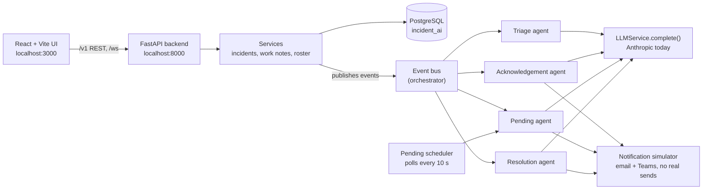

# Resolv — Project Overview

_As of 2026-10-27_

## What it is

**Resolv** is an IT service-desk automation system. AI agents pick up a new incident, route it to the right support team, assign an on-shift engineer, message the caller, chase them while the ticket waits, and close it when they confirm the fix.

It models a ServiceNow-style workflow but runs standalone. Incidents live in its own PostgreSQL database, and email and Teams messages go through a **simulator** that logs them instead of sending anything.

The lifecycle it automates:

1. **New incident** arrives (created in the UI, via API, or bulk-imported).
2. **Triage**: if the incident sits in a generic queue, the LLM picks the specific assignment group. Round-robin then assigns an engineer who is on shift now, according to the uploaded shift roster. The state becomes `in_progress`.
3. **Acknowledgement**: the caller gets one templated acknowledgement. For Salesforce groups, the LLM checks whether the ticket is really an access request that should have been a RITM, and sends a redirect template if so.
4. **Pending**: when an engineer puts the ticket `on_hold`, the LLM reads the latest work note to decide whether the caller owes an action. If they do, a background scheduler sends reminders on a cycle.
5. **Resolution**: when the caller replies, the LLM classifies the reply. If it says the issue is fixed, the engineer is notified and the incident can auto-resolve.

Every agent action is written as a structured work note and an agent-execution log row, so the UI can show a full audit trail.

## Architecture



The UI calls the FastAPI backend. Services write to PostgreSQL and publish domain events. The orchestrator (`backend/app/orchestrator/`) routes each event to the agents subscribed to it:

| Event | Published when | Handled by |
| --- | --- | --- |
| `IncidentCreatedEvent` | An incident is saved | Triage |
| `ReTriageRequestedEvent` | The engineer is cleared or the group is changed | Triage (keeps the current state) |
| `IncidentStateChangedEvent` | Any state transition | Acknowledgement, Pending, Resolution (each filters on its own condition) |

All LLM calls go through the single `LLMService` in `backend/app/ai_platform/services/llm_service.py`.

| Layer | Tech | Location |
| --- | --- | --- |
| Frontend | React 18, Vite 5, Tailwind, React Query, Recharts | `frontend/` |
| API | FastAPI, Uvicorn, WebSocket for live incident updates | `backend/app/api/` |
| Database | PostgreSQL, SQLAlchemy async (`asyncpg`), Alembic migrations | `backend/app/database/`, `backend/alembic/` |
| Agents | Python classes on a shared `BaseAgent` contract | `backend/app/modules/agents/` |
| Notifications | Simulator provider; Microsoft Graph planned | `backend/app/integrations/notifications/` |

## The agents

There are four agents. Each is a pure reasoning class (`backend/app/modules/agents/<name>/agent.py`), and a matching service handles database writes and notifications. Only some of their decisions use the LLM.

| Agent | Fires when | What the LLM decides | Everything else (no LLM) |
| --- | --- | --- | --- |
| Triage | Incident created in state `new`, or engineer removed / group changed | Which specific assignment group, only when the ticket sits in a common queue or has no group | Round-robin pick of an on-shift engineer from the roster; sets `in_progress` |
| Acknowledgement | Triage moves the incident to `in_progress` (once per incident) | Salesforce groups only: is this an access request that belongs in a RITM? | Renders the HTML template and sends it through the simulator |
| Pending | State goes from active to `on_hold` / `pending` | Does the latest work note need action from the caller? | Scheduler sends reminders on a cycle |
| Resolution | The caller's work note moves an `on_hold` incident back to active | Classifies the reply (resolved, completed, more info, ...) | Teams note to the engineer, email to the group, auto-resolve if eligible |

Supporting modules:

- `shift_roster` parses Excel rosters (the `.xlsx` files in the repo are samples) and checks who is on shift.
- `work_notes` stores the audit trail.
- `pending_cycles` tracks reminder state.
- `agent_executions` logs each agent run for the Agent Logs page.

## What you can do in the UI

| Page | Route | Use it to |
| --- | --- | --- |
| Overview | `/dashboard` | See incidents processed, automation rate, agent activity, the automation funnel, pending-cycle stats |
| Incidents | `/incidents`, `/incidents/new`, `/incidents/:id` | List, create, and open incidents; add work notes and change state, which drives the agents |
| Shift Roster | `/shift-roster` | Upload an Excel roster and see who is on shift; triage needs this to assign anyone |
| Bulk Import | `/bulk-import` | Load many incidents at once |
| Agent Logs | `/agent-logs` | Inspect each agent run: trigger, result, errors |

To see the agents work end to end, first upload a roster (for example `backend/Shift_Roster_Today.xlsx`). Then create an incident in one of the roster's groups.

## Is an Anthropic key needed?

**Not to run the app, but yes for the AI decisions.** The UI, database, roster, round-robin assignment, templates and reminders all work without a key. Every LLM call goes through `LLMService.complete()`, which is hard-wired to Anthropic (`ANTHROPIC_API_KEY`; default model `claude-3-5-sonnet-20241022`, an old ID that should be updated if you stay on Anthropic).

Without a key, each agent catches the error and falls back:

| Agent | Behaviour with no key |
| --- | --- |
| Triage | Works if the incident already names a specific group. A common-queue or blank group can't be resolved, so nobody is assigned |
| Acknowledgement | Always sends the standard template; the Salesforce RITM check never runs |
| Pending | Assumes the caller owes an action and sends reminders anyway |
| Resolution | Fails: caller replies aren't classified and nothing auto-resolves |

Anthropic's API is pay-as-you-go and has no ongoing free tier.

## Using Gemini or another free key

**Gemini is supported.** Set these in `backend/.env`, then restart the backend (`--reload` does not watch `.env`):

```
LLM_PROVIDER=gemini
GEMINI_API_KEY=<your Google AI Studio key>
GEMINI_MODEL=gemini-3.5-flash
GEMINI_REASONING_EFFORT=low
```

`LLM_PROVIDER=anthropic` (the default) switches back to Claude. `GET /v1/ai-health` reports which provider is active and whether the key works.

How it was added, and how to add others such as Groq: All four agents call `LLMService.complete(messages)` and expect plain text back. Swapping the provider only means editing that one function and the AI settings; no agent code changes.

The recommended shape:

1. Add `LLM_PROVIDER` (`anthropic` | `gemini` | `groq`) plus `<PROVIDER>_API_KEY` and `<PROVIDER>_MODEL` to `backend/app/core/config/ai.py`.
2. In `LLMService.complete()`, branch on the provider. Gemini and Groq both speak the OpenAI chat format, so one `openai`-package code path can serve both, pointed at different base URLs:
   - Gemini: `https://generativelanguage.googleapis.com/v1beta/openai/`
   - Groq: `https://api.groq.com/openai/v1`
3. Put the system prompt back in as the first message. The current code pulls it out into a separate parameter, which is Anthropic's style.
4. Update `/v1/ai-health` (`backend/app/api/v1/ai_health.py`), which only checks for an Anthropic key today.

The repo already has an unused `groq_client.py`, and the README mentions `GROQ_*` settings. Its default model `llama-3.3-70b-versatile` no longer appears in Groq's current model list, so pick a current model if you go that way.

## Best free AI option

**Recommendation: Google Gemini, using the current Flash model on the free tier.** It gives the best answer quality of the free options, and the free daily quota is far more than this app needs.

The volume is low because this app makes at most about 4 LLM calls per incident (triage, acknowledgement, pending, resolution), and only some incidents need each one. Even 100 incidents a day stays in the low hundreds of requests.

| Option | Answer quality | Free limits (reported) | Trade-offs |
| --- | --- | --- | --- |
| **Gemini Flash** (Google AI Studio key) | Highest of the free options; strong at the short classification and JSON tasks these agents do | Flash-class models are reported at roughly 10–15 RPM and about 1,000–1,500 requests/day. Pro models are mostly not free | Outside the EU/UK/EEA, Google may use free-tier prompts to improve its products. Check your exact quota in AI Studio |
| **Groq** (`openai/gpt-oss-120b`, `qwen/qwen3.8-27b`) | Good; open models are a step below Gemini Flash on instruction following | About 30 RPM, 1,000 requests/day, 8K tokens/min (Groq's published base limits; your own limits are on its console) | Fastest responses. The 8K tokens/min cap can bite during bulk import |
| **OpenRouter `:free` models** | Varies by model | About 20 RPM and 50 requests/day (1,000/day after a one-time $10 credit) | Useful for trying many models; too tight for regular use |
| **Ollama** (local) | Lower; depends on the model your Mac can run | Unlimited, no key | Fully private and offline, but small models follow the JSON prompts less reliably |

How to choose:

- **Default:** use Gemini Flash.
- **If the data can't go to Google's free tier:** use Groq.
- **If nothing may leave the machine:** use Ollama.

The free-tier numbers change often, and third-party reports disagree. Treat the figures above as approximate and confirm them in each provider's console before relying on them.

Sources:

- [Gemini API rate limits (official)](https://ai.google.dev/gemini-api/docs/rate-limits)
- [Gemini OpenAI compatibility (official)](https://ai.google.dev/gemini-api/docs/openai)
- [Groq rate limits (official)](https://console.groq.com/docs/rate-limits)
- [Gemini free tier summary, Oct 2026](https://klymentiev.com/blog/gemini-api-free-tier)
- [Free LLM APIs compared (OpenRouter)](https://openrouter.ai/blog/tutorials/free-llm-apis-compared/)
- [Free LLM API comparison 2026 (Novita)](https://blogs.novita.ai/free-llm-api-comparison-2026/)

## Running it locally

These are the steps that worked on this Mac, which has no Homebrew, Docker or system PostgreSQL. The backend needs Python 3.11 or newer.

```bash
# Backend dependencies (Python 3.11 from ~/.local/bin)
cd backend
~/.local/bin/python3.11 -m venv venv
venv/bin/pip install -e . pgserver      # pgserver ships PostgreSQL binaries

# PostgreSQL from the bundled binaries
PG=$(venv/bin/python -c "import pgserver,os;print(os.path.join(os.path.dirname(pgserver.__file__),'pginstall','bin'))")
$PG/initdb -D ./pgdata -U postgres --auth=trust -E UTF8
$PG/pg_ctl -D ./pgdata -l pg.log -o "-p 5432 -k /tmp" start
$PG/psql -h localhost -U postgres -c "CREATE DATABASE incident_ai;"

# backend/.env (minimum)
#   DATABASE_URL=postgresql+asyncpg://postgres:@localhost:5432/incident_ai
#   ALLOWED_ORIGINS=["http://localhost:3000","http://localhost:8000"]
#   ANTHROPIC_API_KEY=            # or your provider's key once switched

# Migrations: the repo has two heads, so "head" fails; use "heads"
venv/bin/alembic upgrade heads

# Start the API
venv/bin/uvicorn app.main:app --reload --port 8000

# Frontend (second terminal)
cd frontend
npm install
npm run dev     # serves http://localhost:3000 (not 5173 as the README says)
```

Quick checks:

| URL | Expected |
| --- | --- |
| http://localhost:3000 | Resolv dashboard |
| http://localhost:8000/docs | API docs |
| http://localhost:8000/v1/db-health | `{"status":"healthy","database":"connected"}` |
| http://localhost:8000/v1/ai-health | `not_configured` until an LLM key is set |

Known repo issues:

- Alembic has two migration heads; a merge migration would fix `alembic upgrade head`.
- The README says Python 3.9+, but `pyproject.toml` requires 3.11.
- The README gives the frontend port as 5173; it is actually 3000.
